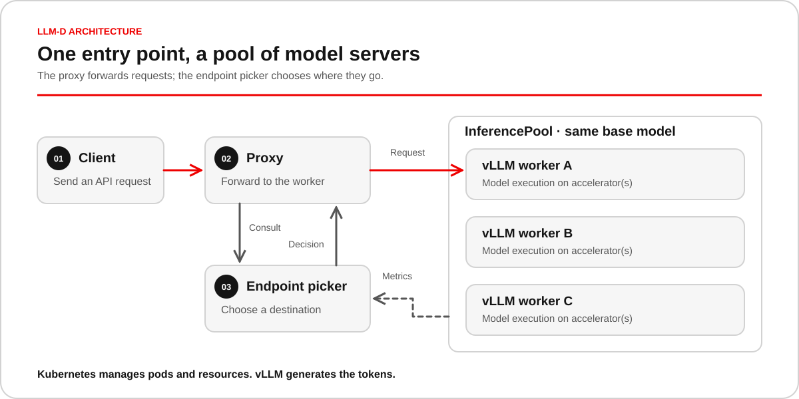
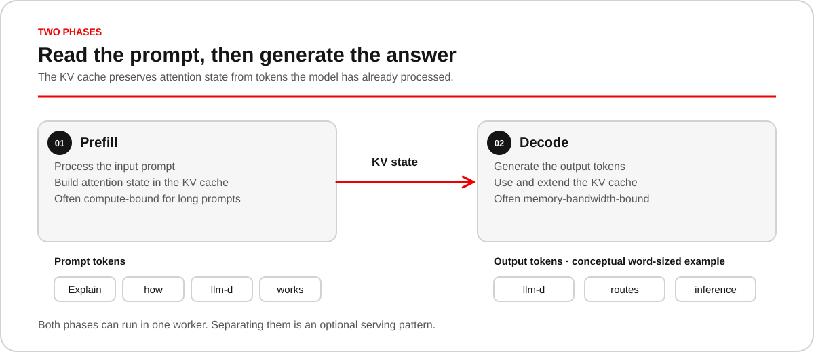
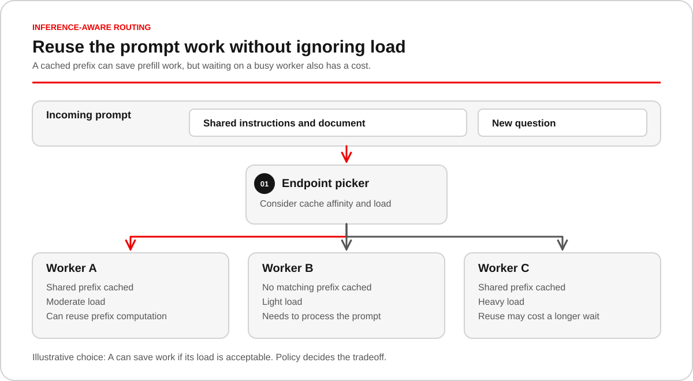
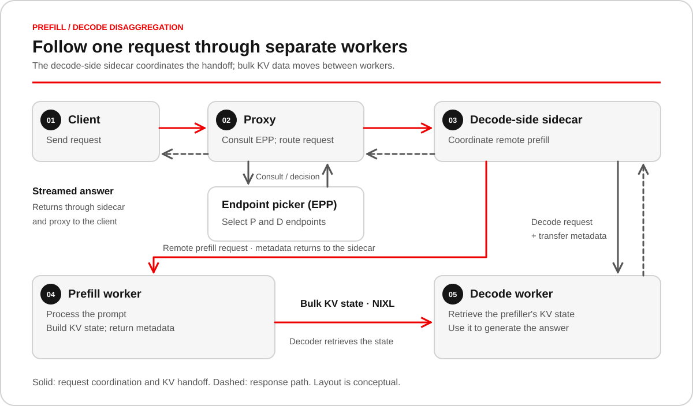
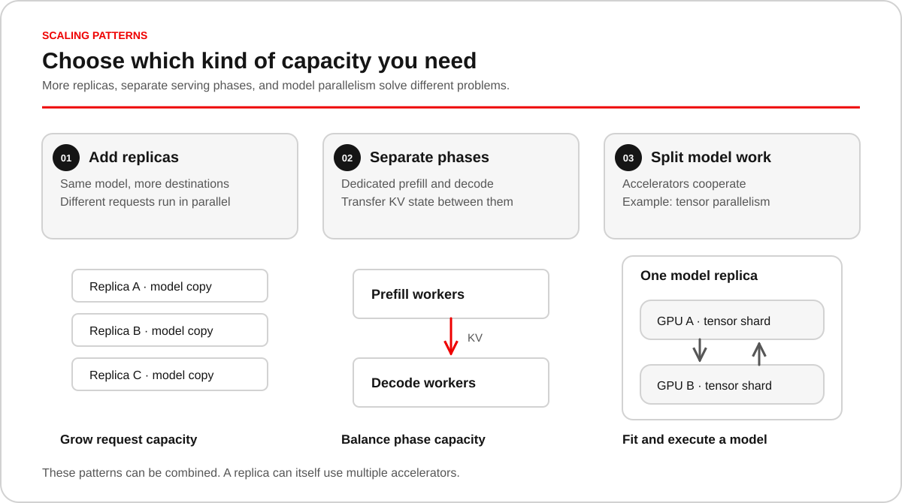
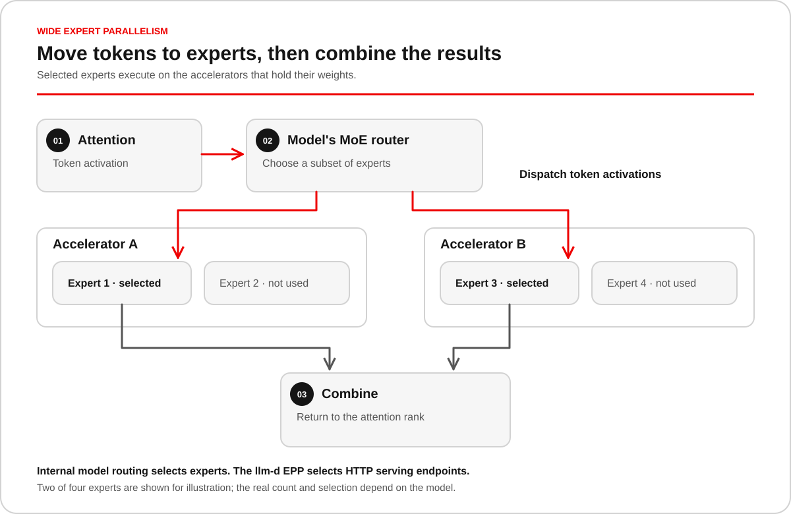

# vLLM Zero to Hero: Scale inference with llm-d

### *This is an extra-credit lesson in the vLLM Zero to Hero series. Follow the [campaign path](https://github.com/red-hat-ai-dev/vLLM-zero-to-hero-overview) to learn more.*

Okay, so you've got a model running, made it more efficient, and measured how
it performs. But what happens when one server can't keep up with everyone who
wants to use it?

That's where [llm-d](https://github.com/llm-d/llm-d) comes in! We can use it to
coordinate inference across a pool of model servers, making decisions about
where requests run and how the work is divided.

In this lesson, we're going to follow the requests through the system. The
diagrams show the moving parts without requiring you to build a cluster first.

For a guide to the files and the scope of this explainer, see
[Behind the scenes](../docs/BEHIND_THE_SCENES.md).

## What you will learn

- Where llm-d fits alongside vLLM and Kubernetes
- Why model-serving requests need more than simple round-robin routing
- How a cached prompt prefix can save work
- What prefill and decode do, and why we might separate them
- How a request and its key-value cache move between workers
- How adding replicas differs from spreading a model across accelerators

This lesson is designed for anyone interested in modern AI inference. You do
not need to be a machine learning researcher or an inference specialist.

## Requirements

Just a browser and some curiosity. Parts [1](https://github.com/red-hat-ai-dev/vLLM-zero-to-hero-pt1),
[2](https://github.com/red-hat-ai-dev/vLLM-zero-to-hero-pt2), and
[3](https://github.com/red-hat-ai-dev/vLLM-zero-to-hero-pt3) give you useful
background, but there are no commands to run here.

An actual deployment needs Kubernetes, supported accelerators, and enough
memory for the model and its working state. The resources depend on the serving
pattern. The multi-node patterns we show later need more hardware and networking
than the local setup used earlier in the series.

All diagrams are conceptual. Worker counts and layouts explain the mechanism;
they are not deployment recommendations or benchmark results.

## 1. Put llm-d around your model servers

vLLM still runs the model and generates tokens. llm-d supplies the routing and
coordination around those model servers. Kubernetes manages the pods and the
resources they use.

The [core architecture](https://llm-d.ai/docs/architecture) has three pieces:

- **Router:** a proxy receives the request and consults an endpoint picker
  (EPP) to choose a model-server endpoint.
- **InferencePool:** a Kubernetes resource identifies model-server pods serving
  the same base model through their labels.
- **Model servers:** vLLM instances do the inference work on accelerators.

  

The picker makes a routing decision. The proxy forwards the request. The pool
is the grouping of servers, not another hop that processes the prompt.

## 2. Understand the two jobs inside a request

Before we split anything across machines, let's look at what generating an
answer involves.

**Prefill** processes the input prompt and builds the model's key-value (KV)
cache: attention state associated with the tokens it has already processed.
**Decode** then generates output tokens, using and extending that state as the
answer grows.

  

For many serving workloads, especially long prompts, prefill is limited by
compute. Decode is often limited by memory bandwidth. The balance depends on
the model, hardware, and batch size. That difference is why the two phases can
benefit from different resource allocations. See the
[prefill and decode guide](https://llm-d.ai/docs/well-lit-paths/foundations/pd-disaggregation).

A long new prompt can also compete with requests that are already streaming
answers. Adding hardware is useful, but we also need to decide which work
should share it.

## 3. Send the request where it makes sense

Imagine two requests: one asks for a short definition; the other includes a
long document and asks for a detailed summary. Counting each as one request
doesn't tell us how much work either server has to do.

Round-robin routing simply takes turns choosing a server. llm-d can consider
signals such as queue depth, active requests, token load, and cache state.
The [optimized baseline](https://llm-d.ai/docs/well-lit-paths/foundations/optimized-baseline)
combines load awareness with prefix awareness.

What's a prefix? It's the beginning of a prompt. Requests might share system
instructions, the same document, or earlier turns in a conversation. If a
server already has compatible cached KV blocks for that prefix, it can reuse
that work and process the remaining input.

  

This caches computation, not a finished answer. The model still generates a
response to the current request. Cache reuse also depends on matching the
actual prompt tokens and the server's cache rules.

llm-d can estimate cache locality from prior routing, or use model-server
events to track cache blocks more precisely. Entries can be evicted, so an
estimate is not a promise that every block is still present. See
[prefix-cache aware routing](https://llm-d.ai/docs/architecture/advanced/kv-management/prefix-cache-aware-routing).

The picker follows a configurable **filter → score → pick** process: narrow
the eligible endpoints, evaluate the candidates, then choose a destination.
The configuration decides how cache affinity and load influence that choice.
A warm cache can save work, but a busy worker can still make the user wait.
See the [request scheduler](https://llm-d.ai/docs/architecture/core/router/epp/scheduling).

## 4. Separate prefill from decode

So far, each worker can process a prompt and generate its answer. That's a
useful starting point. Another option is **prefill/decode disaggregation**:
give prompt processing and token generation separate model-server instances.

We can then allocate and scale those resources separately. Long prompt
processing has its own workers, while ongoing streams have dedicated decode
capacity. Whether this helps depends on the workload and the cost of moving
the KV cache between them.

Let's follow a request through the standard vLLM disaggregated path:

  

1. **Choose the workers.** The proxy consults the EPP. When remote prefill is
   selected, routing information identifies a prefill endpoint and a decode
   endpoint.
2. **Route to the decode side.** The proxy sends the request to a routing
   sidecar beside the chosen decoder. The sidecar coordinates remote prefill.
3. **Process the prompt.** The prefiller builds KV state and returns transfer
   metadata, which the sidecar passes to the decoder.
4. **Move the KV state.** The decoder retrieves that state through the serving
   engine's KV-transfer connector, using NVIDIA Inference Transfer Library
   (NIXL) in this path.
5. **Generate the answer.** The decoder continues generation, and the response
   streams back through the sidecar and proxy to the client.

Request coordination and KV transfer are separate paths. The bulk KV data
moves between workers, not through the endpoint picker. Fast interconnects,
such as those supporting remote direct memory access (RDMA), matter because
the handoff adds communication. TCP transfer can support development and
testing, but shouldn't be treated as equivalent production performance.

Disaggregation is optional. Some requests can use a decoder-only path, and
ordinary combined workers remain useful. The full details are in
[disaggregated serving](https://llm-d.ai/docs/architecture/advanced/disaggregation).

## 5. Choose what you need to scale

"More GPUs" can mean several different things. Let's separate the decisions.

  

**More replicas** give requests more destinations. For a dense model, data
parallel replicas hold copies of the model and handle different requests.
Each replica may itself span several accelerators. This grows serving
capacity; it doesn't make the model smaller. See
[vLLM data parallel deployment](https://docs.vllm.ai/en/latest/serving/data_parallel_deployment/).

**Separate phases** let us change the balance of prompt-processing and
generation capacity. This introduces the cache handoff we just followed.

**Model parallelism** makes accelerators cooperate within a replica. Tensor
parallelism splits tensor operations across them; pipeline parallelism divides
model layers into stages. These patterns can help a model fit and execute
across more hardware, with communication costs of their own. See
[vLLM parallelism and scaling](https://docs.vllm.ai/en/latest/serving/parallelism_scaling/).

These choices can be combined. Routing a request to a model-server endpoint
doesn't tell us whether that server's model fits on one accelerator or spans
several.

### What about mixture-of-experts models?

A mixture-of-experts (MoE) model has groups of expert layers. Inside the model,
a learned router selects a subset of experts for each token. **Expert
parallelism** places experts on different accelerators and moves token
activations to the selected experts, then combines the results.

  

That internal token routing is different from llm-d's HTTP request routing.
The EPP chooses a serving endpoint; vLLM and its communication backends execute
the distributed model. llm-d's
[wide expert parallelism path](https://llm-d.ai/docs/well-lit-paths/foundations/wide-expert-parallelism)
combines multi-node model serving with prefill/decode disaggregation.

Expert dispatch and KV transfer also move different things: token activations
during a model pass versus cached attention state between serving phases.
Neither makes networking free.

## 6. Measure the result before adding more

Remember Part 3? We still need to measure the endpoint under the workload we
actually care about. Include prompt lengths, output lengths, concurrency, and
prefix reuse when comparing configurations.

- **Time to first token (TTFT):** does prompt processing and routing get the
  answer started within the target?
- **Inter-token latency (ITL):** do ongoing responses stream smoothly?
- **Throughput:** how much work completes while meeting those latency targets?
- **Queue depth and cache utilization:** where is pressure building?
- **KV-transfer time and errors:** is the handoff helping or becoming a bottleneck?

Adding a replica takes time: it needs an accelerator, model weights, and a ready
server. Routing chooses among available workers; autoscaling changes how many
workers are available. Kubernetes autoscaling integrations can consume
inference metrics, but they need to be configured. See
[llm-d autoscaling](https://llm-d.ai/docs/architecture/advanced/autoscaling).

Small workloads might be served well by a single vLLM instance. Larger ones
can benefit from additional replicas, smarter placement, or specialized
workers. Use the measurements to choose the next change.

## What to try next

Start with the [llm-d architecture guide](https://llm-d.ai/docs/architecture)
to connect these diagrams to the actual components. If you have access to a
supported Kubernetes environment, the
[official quickstart](https://llm-d.ai/docs/getting-started/quickstart) starts
with combined workers and inference-aware routing.

Then explore the
[well-lit paths](https://llm-d.ai/docs/well-lit-paths) for the pattern your
workload needs. You can keep learning the architecture even if your local
machine only has one accelerator.

## Questions or feedback

If something is unclear, [open an issue](https://github.com/red-hat-ai-dev/vllm-zero-to-hero-extra-credit/issues/new)
with the section or diagram you're reading and what you would like explained.

---

[Back to extra credit](../README.md) · [Back to the vLLM Zero to Hero overview](https://github.com/red-hat-ai-dev/vLLM-zero-to-hero-overview)
